# HomeLab with Tailscale VPN and Incus

This repository configures a private Debian 13 homelab on Incus, accessible
through Tailscale. It contains Ansible roles, Kubernetes manifests and Helm
values, Vault policies, and operational runbooks.

## Architecture

One host runs DNS, PostgreSQL, SeaweedFS, Gitea, Harbor, an Actions runner,
Uptime Kuma, Vault, and a four-node Kubernetes cluster.

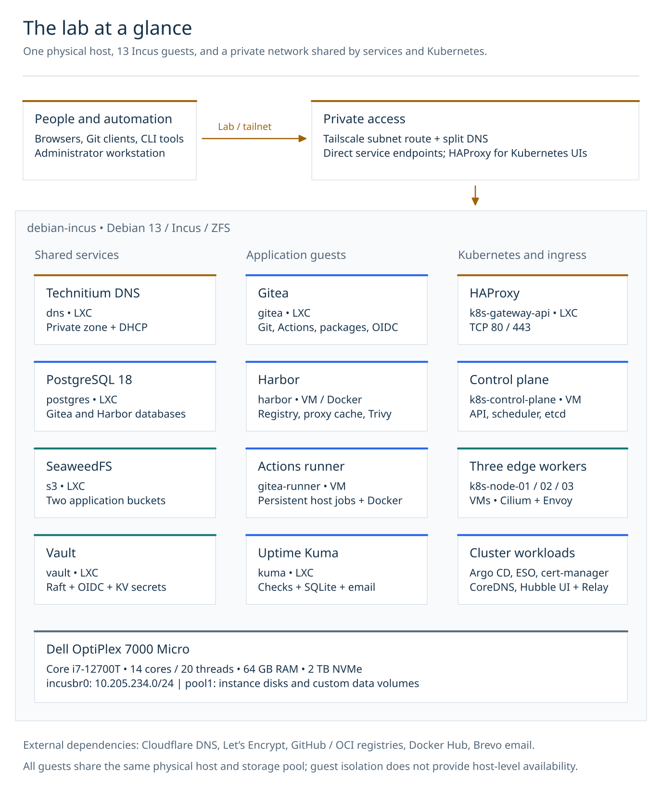

The [architecture guide](docs/architecture.md) covers service dependencies,
private DNS, storage, identity, Kubernetes packet paths, and recovery.
[Editable Excalidraw sources and SVG previews](docs/diagrams/README.md) accompany
each diagram.

## Service showcase

Screenshots from the private lab. Select an image to view it at full size.

| Technitium DNS — query traffic | Gitea — Actions workflows |
| --- | --- |
| [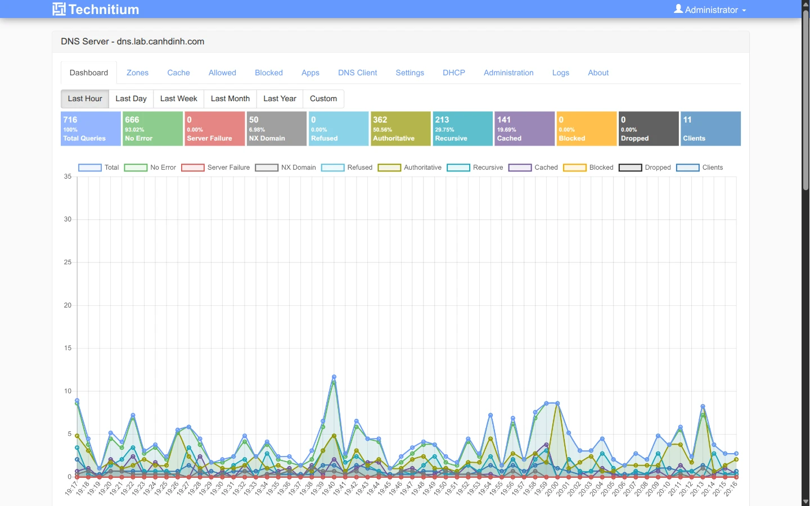](docs/images/services/technitium-dns.webp) | [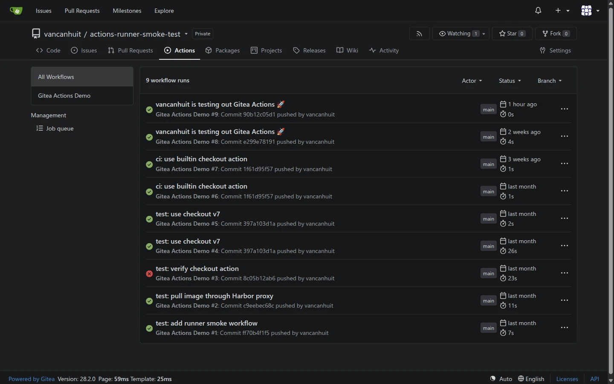](docs/images/services/gitea-actions.webp) |

| Harbor — registry projects | Argo CD — Kubernetes applications |
| --- | --- |
| [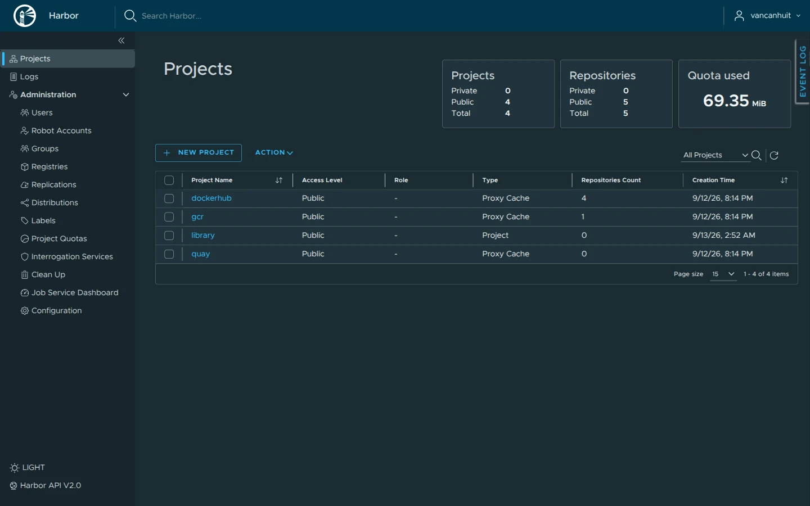](docs/images/services/harbor-projects.webp) | [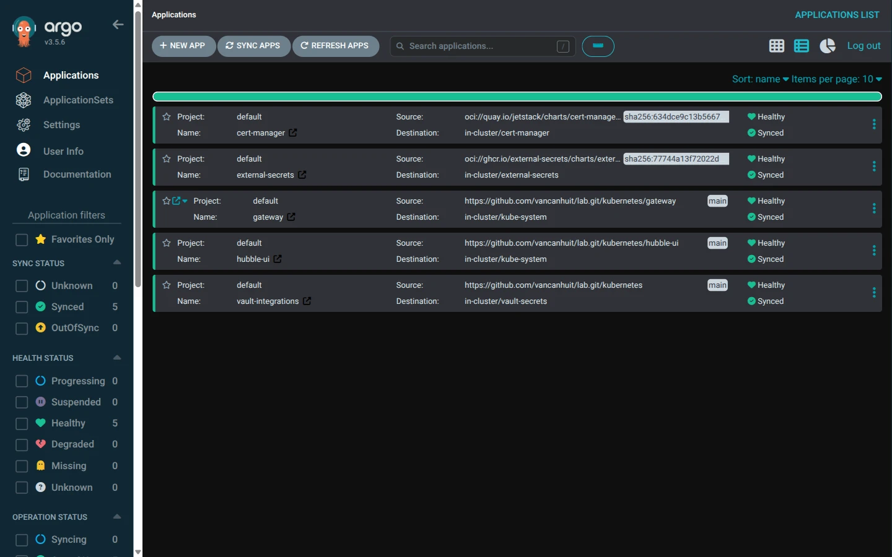](docs/images/services/argocd-applications.webp) |

| Harbor — Trivy scanner | Harbor — Security Hub |
| --- | --- |
| [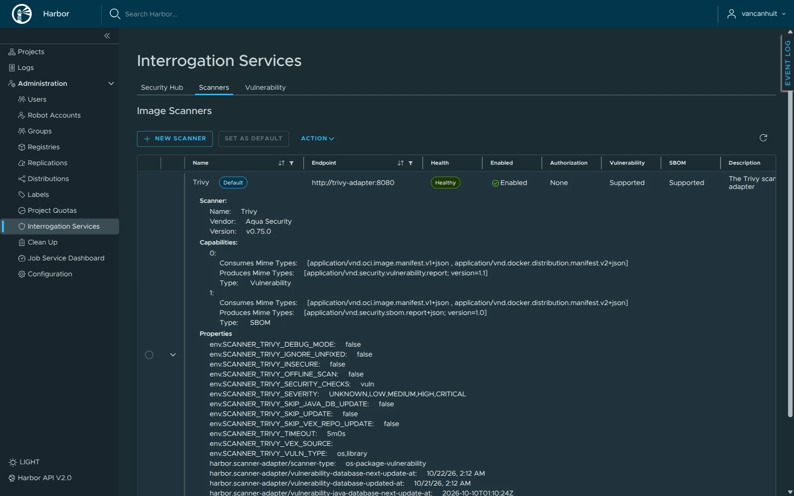](docs/images/services/harbor-trivy-scanner.webp) | [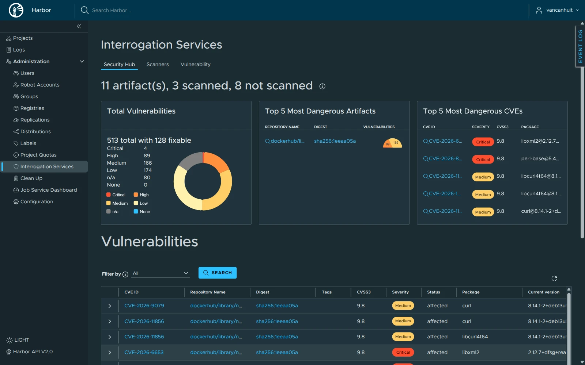](docs/images/services/harbor-security-hub.webp) |

| Harbor — vulnerability scanning |
| --- |
| [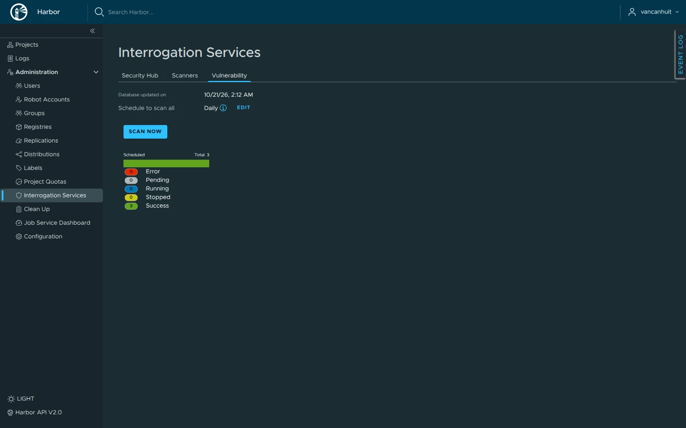](docs/images/services/harbor-vulnerability.webp) |

| Uptime Kuma — service monitoring | Uptime Kuma — Gitea monitor details |
| --- | --- |
| [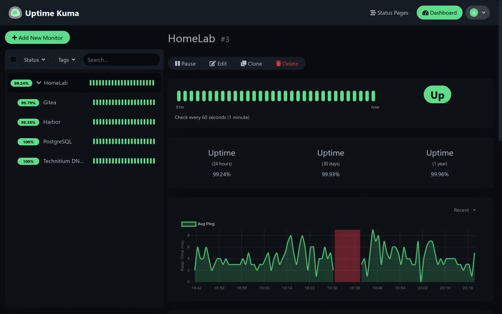](docs/images/services/uptime-kuma.webp) | [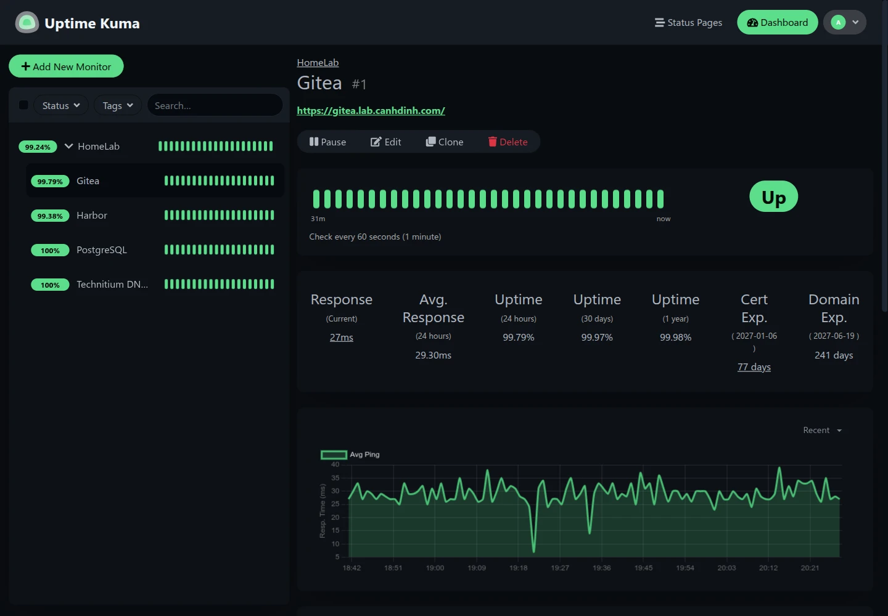](docs/images/services/uptime-kuma-gitea.webp) |

| SeaweedFS Master — cluster topology | SeaweedFS Filer — S3 buckets |
| --- | --- |
| [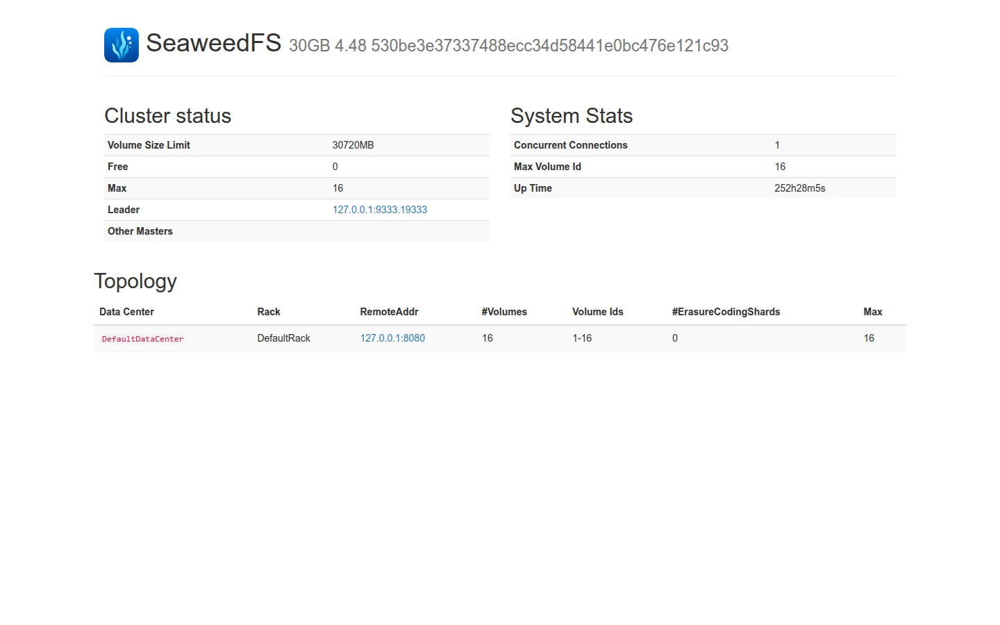](docs/images/services/seaweedfs-master.webp) | [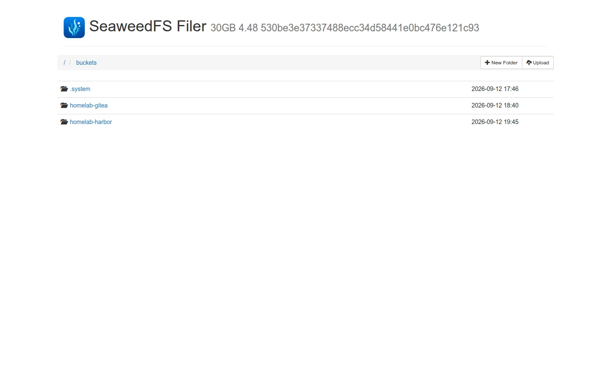](docs/images/services/seaweedfs-filer.webp) |

| SeaweedFS Volume — storage usage |
| --- |
| [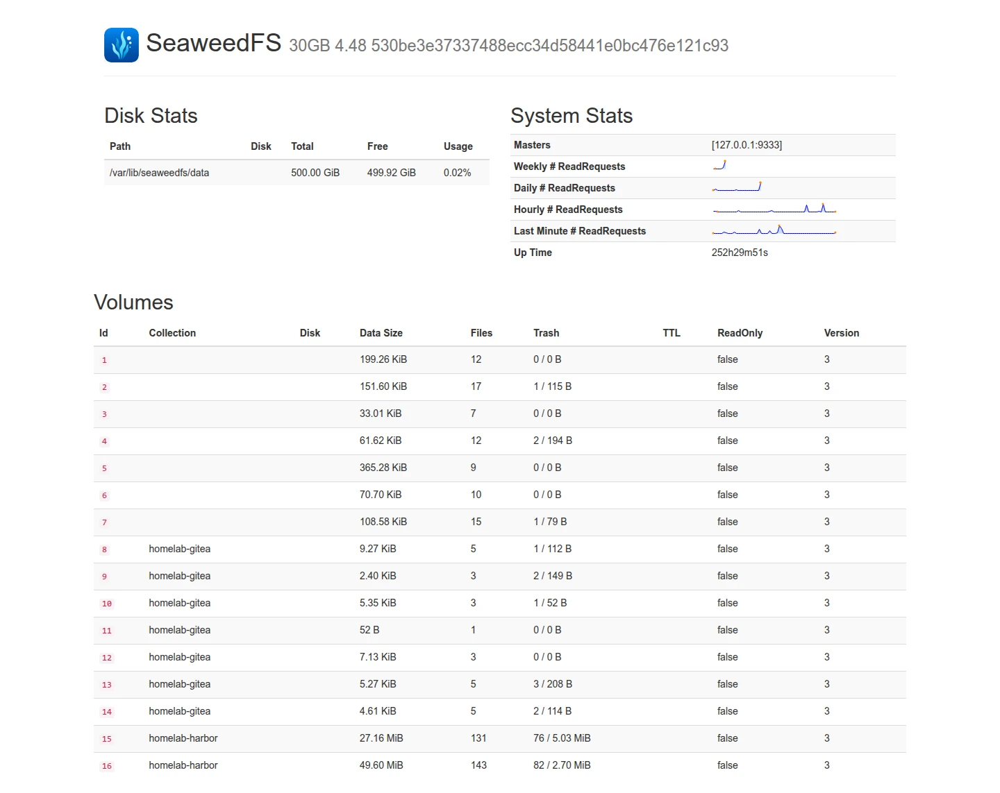](docs/images/services/seaweedfs-volume.webp) |

## Environment

| Component | Configuration |
| --- | --- |
| Hardware | Dell OptiPlex 7000 Micro, Intel Core i7-12700T (14 cores, 20 threads), 64 GB RAM, 2 TB NVMe SSD |
| Public domain | `canhdinh.com`, hosted by [Cloudflare DNS](https://developers.cloudflare.com/dns/) |
| Private domain | `lab.canhdinh.com`, served by Technitium and reached through [Tailscale split DNS](https://tailscale.com/kb/1054/dns#restricted-nameservers) |
| Host OS | Debian 13 |
| Virtualization | [Incus](https://linuxcontainers.org/incus/docs/main/) with ZFS storage |
| Guest network | `incusbr0`, `10.205.234.0/24`, advertised through the host's Tailscale subnet router |
| Kubernetes | One kubeadm control plane and three workers, with containerd, Cilium, and a separate HAProxy ingress |

The Incus host uses Zabbly builds for:

- [Incus](https://github.com/zabbly/incus)
- [ZFS](https://github.com/zabbly/zfs)
- [Linux kernel](https://github.com/zabbly/linux)

## Getting started

Start with the [prerequisites and access setup](docs/getting-started.md), then
configure [encrypted secrets and your age identity](docs/secrets.md).
After installing `mise`, run these commands from the repository root to install
the pinned tools, Ansible collections, and Git hooks:

```sh
mise install
mise run ansible:deps
mise run hooks:install
```

Provision the host and guests with the [Incus runbook](docs/incus.md), then
follow the [service deployment sequence](docs/deployment.md). Deploy cluster
applications through the separate [Kubernetes application runbook](kubernetes/README.md).
Run Ansible commands from `ansible/`; run Helm, `kubectl`, and Vault commands from
the repository root unless the runbook says otherwise.

## Configuration ownership

Use the workflow for the resource you are changing:

| Location | Responsibility |
| --- | --- |
| [`ansible/`](ansible/) | Service guests, kubeadm, containerd, Cilium and its Hubble workloads, node firewalls, and HAProxy |
| [`kubernetes/`](kubernetes/README.md) | Helm values, application manifests, and manual-sync Argo CD Applications; Ansible does not deploy these applications |
| [`vault/`](vault/README.md) | Vault authentication roles and policies, applied with the Vault CLI |
| [`ansible/group_vars/`](ansible/group_vars/) and [`ansible/host_vars/`](ansible/host_vars/) | Host/group configuration and ownership-scoped SOPS-encrypted service credentials |
| [`secrets/vault/`](secrets/vault/) | Encrypted operator recovery material, outside Ansible inventory |

External Secrets Operator (ESO) copies the Cloudflare and Argo CD login
credentials from Vault into Kubernetes Secrets. Their SOPS files are recovery
backups. Private DNS records and DHCP settings are managed in Technitium.

## Local tests

Run the controller-local test suite from the repository root:

```bash
mise run ansible:test
```

The suite checks Ansible compatibility, role templates, Kubernetes manifests,
Vault policies, and Kuma backup behavior using an isolated localhost inventory.
It needs no live hosts or age identity. Helm checks download the pinned
cert-manager, Argo CD, and ESO charts, so registry access is required.

Run service verification playbooks from `ansible/` after deployment, following
the relevant runbook. `verify-kuma.yaml` creates a backup and applies retention.
`verify-inventory-vars.yaml` checks encrypted variable ownership and requires the
configured age identity.

List other tasks with `mise task ls`. Git hooks enforce Conventional Commits
and run full-history secret scans before pushes; see
[tooling and hook setup](docs/getting-started.md#install-tooling).

## Documentation

Use these runbooks for setup, verification, maintenance, and recovery:

| Guide | Contents |
| --- | --- |
| [Secret management](docs/secrets.md) | SOPS, age identities, encrypted inventory variables, and key rotation |
| [Incus](docs/incus.md) | Host bootstrap, bridge networking, SSH keys, and instance creation |
| [TLS certificates](docs/tls.md) | Host-service certificates, lego renewal, deployment hooks, and troubleshooting |
| [Deployment](docs/deployment.md) | DNS setup, service dependency order, and verification commands |
| [PostgreSQL and backups](docs/backups-and-postgresql.md) | Data volumes, backup coverage, and point-in-time restore |
| [SeaweedFS](docs/seaweedfs.md) | S3 administrative UIs, access controls, and credential rotation |
| [Harbor operations](docs/harbor.md) | Registry use, vulnerability scanning, lifecycle, and upgrades |
| [Gitea operations](docs/gitea.md) | Initial access, repositories, object storage, recovery, and upgrades |
| [Gitea Actions runner](docs/gitea-runner.md) | VM provisioning, host workflows, and upgrades |
| [Uptime Kuma operations](docs/uptime-kuma.md) | Initial setup, monitoring, backup, restore, upgrade, and troubleshooting |
| [Vault operations](docs/vault.md) | Single-node systemd deployment, private initialization, unsealing, TLS, and snapshots |
| [Vault login and policies](vault/README.md) | Gitea single sign-on, authorization, and recovery |
| [Kubernetes](docs/kubernetes.md) | Kubeadm, Cilium, Hubble, private Gateway access, and cluster limits |
| [Kubernetes applications](kubernetes/README.md) | Helm and kubectl deployment, Vault credentials, and Argo resource ownership |
| [Argo CD](kubernetes/argocd/README.md) | Deployment, Gitea single sign-on, Applications, and manual sync |
| [External Secrets Operator](kubernetes/external-secrets/README.md) | Namespaced Vault authentication and Kubernetes Secret delivery |
| [cert-manager credentials](kubernetes/cert-manager/README.md) | Cloudflare token setup, rotation, and recovery |
| [Argo CD credentials](kubernetes/argocd/vault-secrets.md) | Vault-sourced login credentials and recovery |

## Recovery boundaries

All guests share one physical host and ZFS pool. Kubernetes has one control
plane and one HAProxy ingress. Local snapshots and application backups do not
protect against loss of the host or pool; see
[storage and recovery](docs/architecture.md#storage-and-recovery).

Remove upgrade-specific snapshots and archives after all upgrade checks pass.
Routine backups, TLS state, and recovery credentials have separate retention
requirements. Follow the [backup cleanup policy](docs/backups-and-postgresql.md#backup-coverage)
and the service's runbook.
