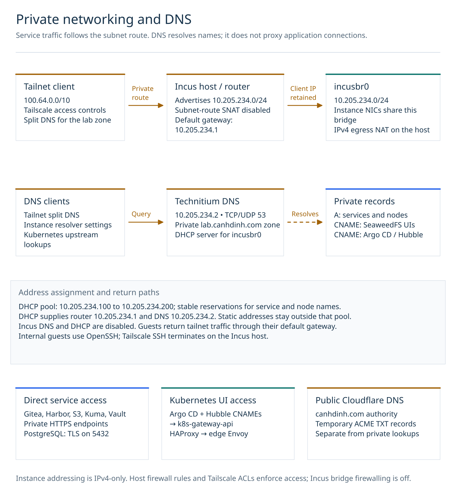
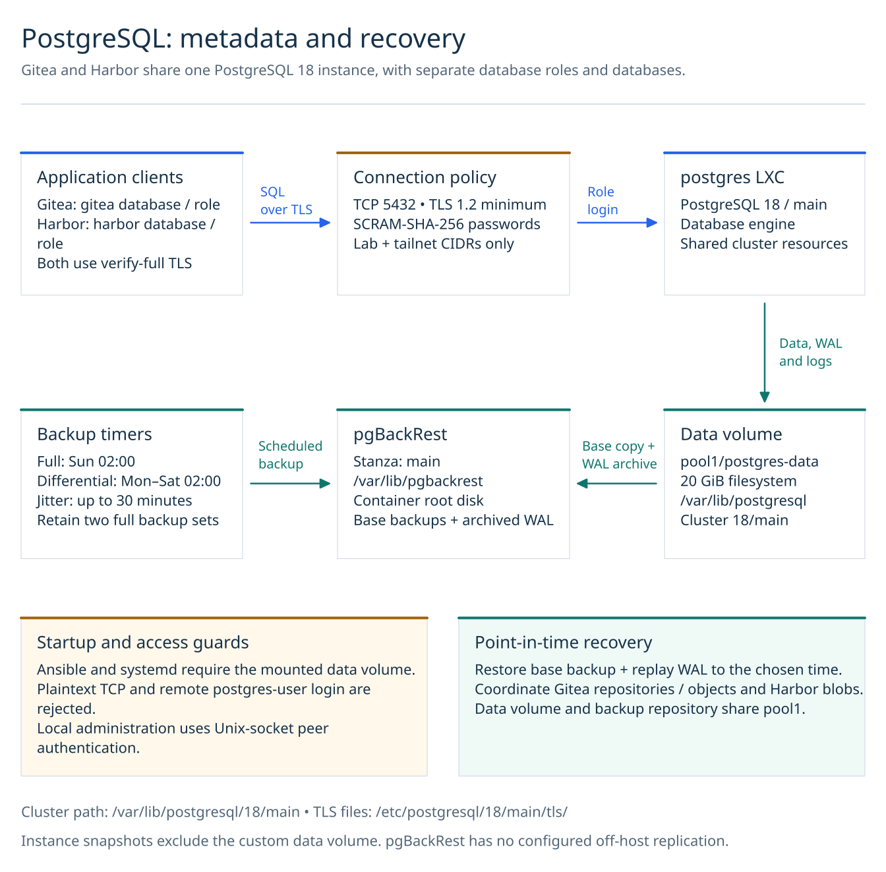
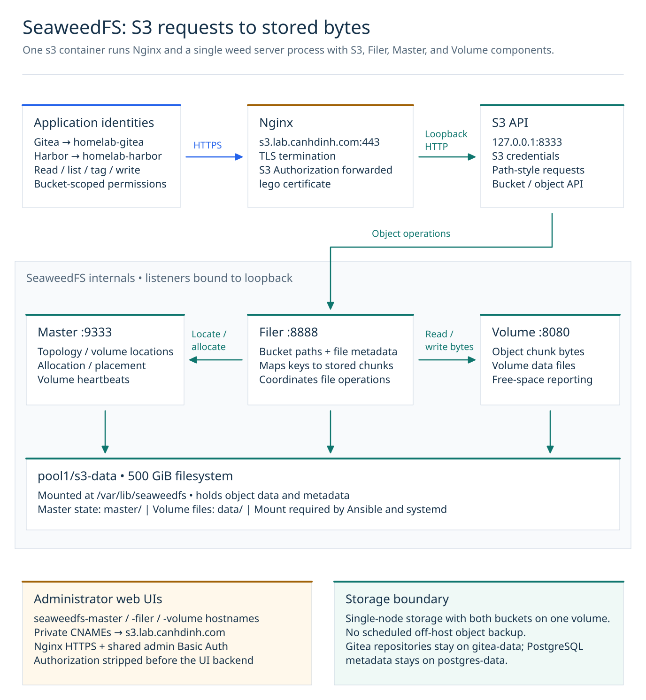
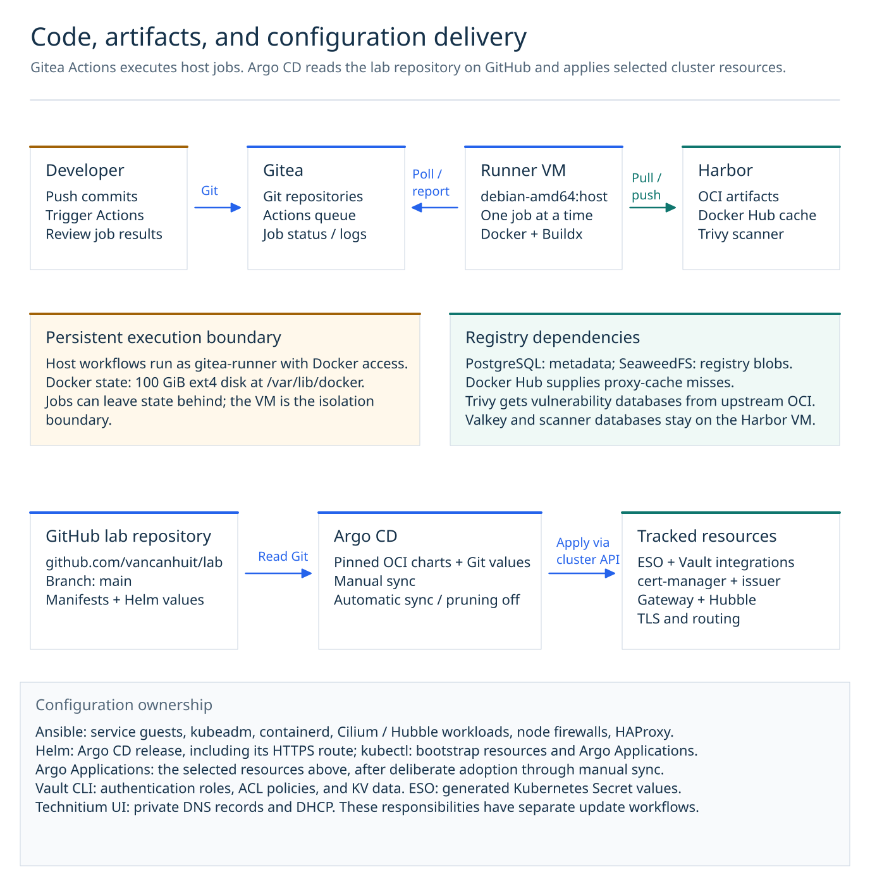
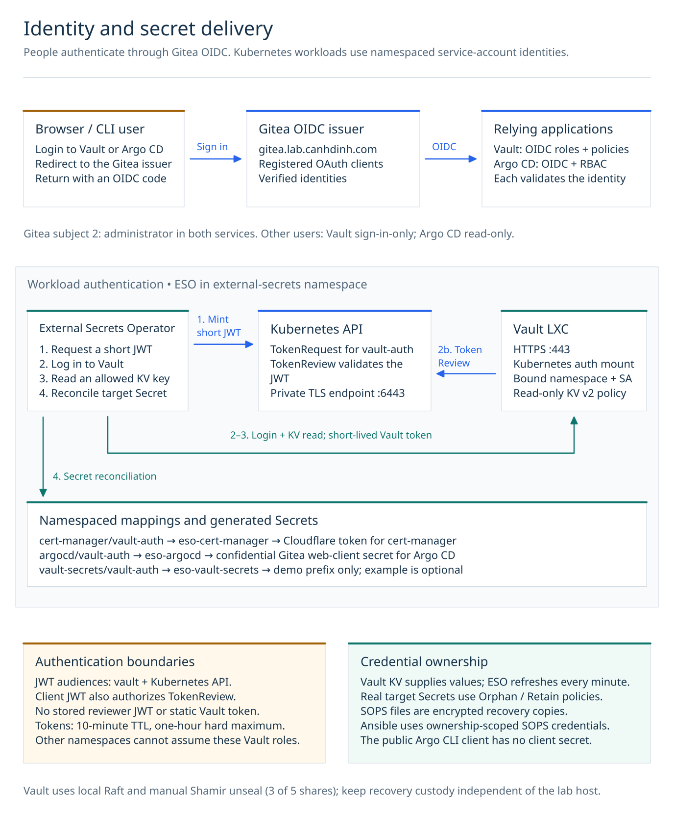
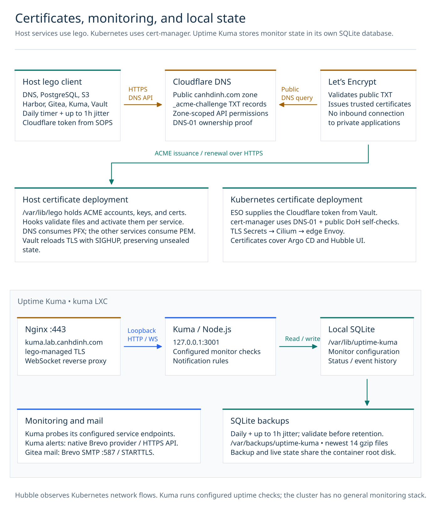
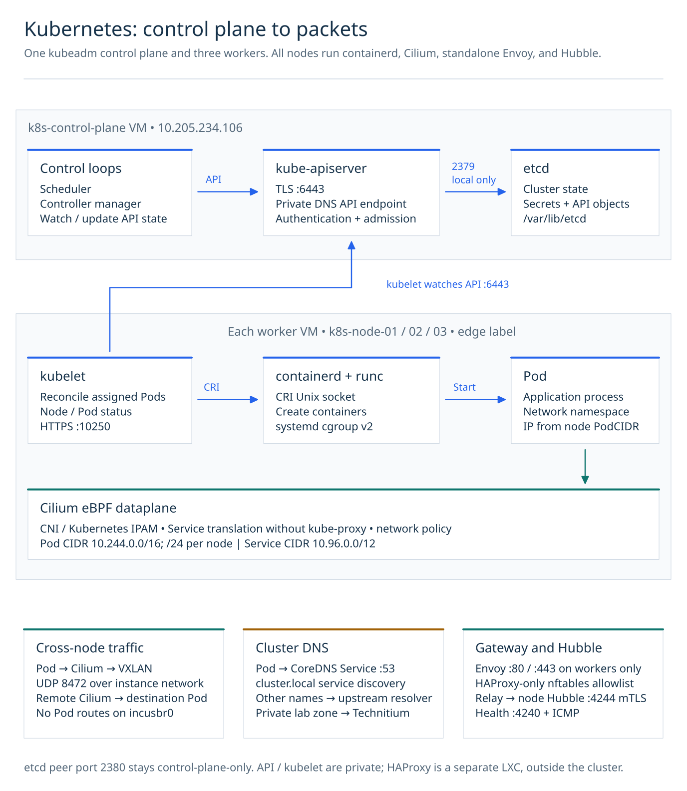
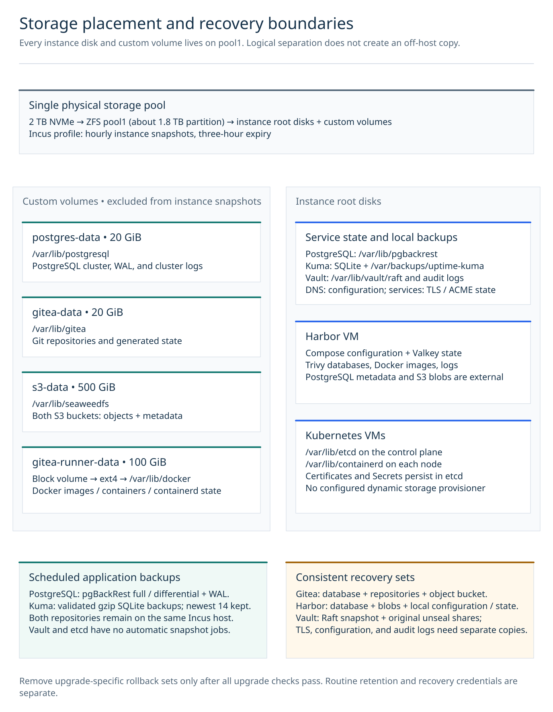

# Lab architecture

The lab runs on one Dell OptiPlex 7000 Micro with an i7-12700T, 64 GB of RAM, and a
2 TB NVMe SSD. Debian 13 hosts Incus containers and virtual machines backed by
the `pool1` ZFS pool. Private services and Kubernetes nodes share `incusbr0`.

| View | What it explains |
| --- | --- |
| [Whole lab](#whole-lab) | Hardware, guest placement, and service roles |
| [Networking and DNS](#networking-and-dns) | Tailscale routing, DHCP, private records, and public DNS |
| [PostgreSQL](#postgresql) | Application databases, TLS, WAL, and point-in-time recovery |
| [Object storage](#object-storage) | S3 authentication, SeaweedFS components, and disk placement |
| [Code and configuration delivery](#code-and-configuration-delivery) | Gitea Actions, Harbor, GitHub, Argo CD, and resource ownership |
| [Identity and secrets](#identity-and-secrets) | Gitea OIDC, Vault, Kubernetes authentication, and ESO |
| [Certificates and monitoring](#certificates-and-monitoring) | Host TLS renewal, Kuma, notifications, and SQLite backups |
| [Kubernetes](#kubernetes) | Node topology, runtime, packet paths, Gateway access, and TLS delivery |
| [Storage and recovery](#storage-and-recovery) | Root disks, custom volumes, backup coverage, and failure boundaries |

Open an SVG for a full-size view. Each diagram has an editable Excalidraw source;
the [diagram index](diagrams/README.md) lists every source and preview. Arrows
identify the request, operation, or data transfer named beside them. Pale panels
group components by host or responsibility; they are not firewall boundaries.

## Whole lab

[Editable source](diagrams/lab-overview.excalidraw)

Gitea and Harbor use PostgreSQL for relational metadata and SeaweedFS for
objects. Git repositories have their own Gitea volume. Vault uses integrated
Raft storage, and Kuma uses SQLite. Neither depends on PostgreSQL or S3.

The Kubernetes cluster contains one control plane and three workers. Its
HAProxy ingress runs in a separate container. All thirteen guests share the
physical host, power, network uplink, and storage pool.

| Guest | Type | Private IPv4 | Role |
| --- | --- | --- | --- |
| `dns` | LXC | `10.205.234.2` | Technitium DNS and DHCP |
| `postgres` | LXC | `10.205.234.100` | Gitea and Harbor databases |
| `gitea` | LXC | `10.205.234.101` | Git, Actions coordination, packages, OIDC |
| `kuma` | LXC | `10.205.234.102` | Uptime checks and notifications |
| `s3` | LXC | `10.205.234.103` | SeaweedFS S3 and administrative UIs |
| `harbor` | VM | `10.205.234.104` | OCI registry, Docker Hub proxy cache, Trivy |
| `gitea-runner` | VM | `10.205.234.105` | Persistent Actions host jobs and Docker |
| `k8s-control-plane` | VM | `10.205.234.106` | Kubernetes API, control loops, etcd |
| `k8s-node-01` | VM | `10.205.234.107` | Worker and Gateway edge node |
| `k8s-node-02` | VM | `10.205.234.108` | Worker and Gateway edge node |
| `k8s-node-03` | VM | `10.205.234.109` | Worker and Gateway edge node |
| `k8s-gateway-api` | LXC | `10.205.234.110` | HAProxy TCP ingress |
| `vault` | LXC | `10.205.234.111` | Secrets, policies, and authentication |

Guest DNS names append `.lab.canhdinh.com`. Keep DHCP reservations and private
records consistent with this address plan; Ansible connects by hostname.
The [inventory](../ansible/inventory.yaml) defines host groups, and the
[Incus runbook](incus.md) covers provisioning and volume attachment.

## Networking and DNS

[Editable source](diagrams/lab-network-dns.excalidraw)

The Incus host advertises `10.205.234.0/24` to Tailscale and disables SNAT for
subnet routes. Services see the original tailnet client address. Guest replies
use the default gateway, `10.205.234.1`, which is also the subnet router.
Outbound IPv4 traffic uses the host's NAT. Incus DNS, DHCP, bridge firewalling,
and IPv6 addressing are disabled; host firewall rules and Tailscale ACLs control
access.

Technitium at `10.205.234.2` resolves the private `lab.canhdinh.com` zone.
Tailscale split DNS sends queries for that suffix to Technitium. The DHCP pool
is `.100` through `.200`, with stable reservations for service guests and nodes.
Incus guests use standard OpenSSH as `admin`; the host uses Tailscale SSH as `lab`.

Private CNAMEs map `seaweedfs-master`, `seaweedfs-filer`, and `seaweedfs-volume`
to `s3.lab.canhdinh.com`. `hubble-ui` and `argocd` map to
`k8s-gateway-api.lab.canhdinh.com`. Cloudflare hosts the public `canhdinh.com`
zone and ACME validation TXT records. Certificate issuance needs no public
application A record or inbound connection.

See [bridge and subnet routing](incus.md#incus-network-bridge),
[DNS setup](deployment.md#1-deploy-dns), and [DNS-01](tls.md#why-dns-01-works-for-internal-services).

## PostgreSQL

[Editable source](diagrams/lab-postgresql.excalidraw)

Both clients use `verify-full` TLS against `postgres.lab.canhdinh.com:5432`.
The server requires SCRAM-SHA-256 for allowed lab and tailnet addresses, rejects
plaintext TCP, and denies remote login as the `postgres` superuser. Local
administration uses Unix-socket peer authentication.

`gitea` and `harbor` are separate databases and roles in the same PostgreSQL 18
cluster. Data, WAL, and cluster logs live under `/var/lib/postgresql/18/main`
on the 20 GiB `postgres-data` custom volume. Both Ansible and systemd require
the mount before starting or changing the service.

pgBackRest stores base backups and archived WAL at `/var/lib/pgbackrest` on the
container root disk. Full backups run Sunday at 02:00; differential backups run
Monday through Saturday at 02:00, with up to 30 minutes of jitter. Retention
keeps two full backup sets. Restoring the database alone does not restore
Gitea repositories or either application's S3 objects.

Sources: [connection policy](../ansible/roles/postgresql/templates/pg_hba.conf.j2),
[server settings](../ansible/roles/postgresql/templates/postgresql.conf.j2),
[backup defaults](../ansible/roles/postgresql/defaults/main.yaml), and
[PostgreSQL recovery](backups-and-postgresql.md).

## Object storage

[Editable source](diagrams/lab-object-storage.excalidraw)

Nginx terminates TLS at `s3.lab.canhdinh.com:443` and forwards S3 requests to
`127.0.0.1:8333`. Gitea's identity accesses `homelab-gitea`; Harbor's accesses
`homelab-harbor`. Each has bucket-scoped read, list, tagging, and write permissions.

One `weed server` process runs the S3 API, Filer, Master, and Volume components.
The Filer maps paths and metadata to file chunks, the Master tracks topology
and volume placement, and the Volume server stores bytes. All listeners bind
to loopback. Their persistent data uses `pool1/s3-data`, mounted at
`/var/lib/seaweedfs`; Ansible and systemd enforce that mount.

The administrative UIs use separate HTTPS hostnames and a shared Basic Auth
account. Nginx strips that UI Authorization header before proxying. S3 requests
retain their S3 authentication header. The object store contains Gitea LFS,
attachments, packages, Actions data, and other configured objects; Git
repositories remain on `gitea-data`.

Sources: [service command](../ansible/roles/seaweedfs/templates/seaweedfs.service.j2),
[S3 identity policy](../ansible/roles/seaweedfs/templates/s3.json.j2),
[Gitea storage](gitea.md), and [SeaweedFS UI access](seaweedfs.md).

## Code and configuration delivery

[Editable source](diagrams/lab-delivery.excalidraw)

Actions jobs labeled `debian-amd64` execute directly on the runner VM, one at a
time, under `gitea-runner`. Docker access gives jobs effective root control of
that VM. Workspaces and Docker state can persist between jobs. Harbor provides
registry storage, a Docker Hub proxy-cache project, and Trivy scanning.

Argo CD's Applications read `https://github.com/vancanhuit/lab.git` on `main`.
They combine Git manifests or values with pinned OCI charts. Manual sync applies
the selected resources; automatic sync, pruning, and deletion finalizers are off.
The Actions runner has no configured automatic deployment link to these
Applications.

Ansible owns service guests and cluster infrastructure, including Cilium's
Hubble workloads. Argo owns its selected application resources after adoption.
ESO writes generated Secret values, while Vault policies and KV data are
managed through the Vault CLI. The Argo CD release itself uses its Helm workflow.

See [runner execution](gitea-runner.md), [Harbor](harbor.md),
[Argo Applications](../kubernetes/argocd/README.md#external-secrets-operator-application),
and [application ownership](../kubernetes/README.md).

## Identity and secrets

[Editable source](diagrams/lab-identity-secrets.excalidraw)

Gitea is the OIDC issuer for Vault and Argo CD. Both grant administrator access
to subject `2`. Other Gitea users receive sign-in-only access in Vault and
read-only access in Argo CD. Argo's confidential web client uses a secret;
its public CLI client does not.

ESO uses a namespaced `vault-auth` service account for each Vault integration.
TokenRequest grants name that account explicitly. JWTs carry both `vault` and
the Kubernetes API audience. Vault sends TokenReview to the private API using
the client JWT as the reviewer credential. No static Vault token or long-lived
reviewer JWT is stored.

| Namespace / service account | Vault role | Allowed KV v2 data path |
| --- | --- | --- |
| `cert-manager/vault-auth` | `eso-cert-manager` | `secret/data/kubernetes/cert-manager/cloudflare-api-token` |
| `argocd/vault-auth` | `eso-argocd` | `secret/data/kubernetes/argocd/gitea-oidc` |
| `vault-secrets/vault-auth` | `eso-vault-secrets` | `secret/data/kubernetes/vault-secrets/*` for the optional example |

Vault tokens have a ten-minute TTL and a one-hour hard maximum, without the
default policy. Real ExternalSecrets refresh every minute and use Orphan/Retain
policies. Vault supplies active values; SOPS files are encrypted recovery copies.
The ESO controller itself retains broad Kubernetes Secret permissions, so its
service account is privileged infrastructure.

Vault runs outside Kubernetes with local Raft storage and manual Shamir unseal:
three of five shares are required after a restart. Its Kubernetes authentication
requires the cluster API; human OIDC login requires Gitea. Keep recovery access
and unseal custody available independently of those services.

See [Vault SSO](../vault/README.md), [Vault operations](vault.md),
[ESO authentication](../kubernetes/external-secrets/README.md#access-boundaries),
[Cloudflare credentials](../kubernetes/cert-manager/README.md), and
[Argo credentials](../kubernetes/argocd/vault-secrets.md).

## Certificates and monitoring

[Editable source](diagrams/lab-operations.excalidraw)

Host services use lego with SOPS-sourced Cloudflare credentials. Its daily
renewal timer has up to one hour of jitter. ACME accounts, certificates, and keys
persist in `/var/lib/lego`; service hooks validate and activate renewed material.
Technitium consumes PFX. The other services consume PEM, and Vault reloads TLS
with SIGHUP to preserve its unsealed state.

Kuma's Nginx listener proxies HTTPS and WebSockets to Node.js on
`127.0.0.1:3001`. Monitor configuration and history use local SQLite.
The native Brevo provider sends notifications through its HTTPS API; Gitea
uses Brevo SMTP on port 587 with STARTTLS. Kuma's daily backup validates a gzip
SQLite copy before retaining the newest 14 archives on the same root disk.
Hubble provides Kubernetes flow visibility separately from Kuma's configured
uptime checks.

See [TLS deployment hooks](tls.md#service-deployment-hooks),
[Kuma configuration](uptime-kuma.md), and [the Kubernetes certificate flow](#kubernetes-certificates).

## Kubernetes

### Node placement

[Editable source](diagrams/kubernetes-topology.excalidraw)

Each node is a Debian 13 VM with two vCPUs and 4 GiB RAM. HAProxy is outside the
cluster. Workers carry `node-role.kubernetes.io/edge`; only those nodes bind
Gateway ports 80 and 443. Cilium agents and standalone Envoy run on all nodes
for networking and L7 policy processing.

### Runtime and packet paths

[Editable source](diagrams/lab-kubernetes-runtime.excalidraw)

The scheduler and controller manager reconcile through the API. kubelet watches
assigned Pods and calls containerd through its CRI Unix socket; containerd uses
runc to create containers. Runtime cgroups use systemd and unified cgroup v2.
Cilium provides Kubernetes IPAM and replaces kube-proxy with eBPF Service routing.

The Pod network is `10.244.0.0/16`, with a `/24` per node. Cross-node traffic uses
VXLAN over the instance network, so `incusbr0` needs no Pod routes. The Service
CIDR is `10.96.0.0/12`. CoreDNS resolves `cluster.local` and forwards other queries
through `/etc/resolv.conf`; private lab queries reach Technitium.

| Connection | Protocol / port | Boundary |
| --- | --- | --- |
| Administrator, nodes, or Vault to API | TCP 6443 | Private control-plane endpoint |
| Node administration to kubelet | TCP 10250 | Node network |
| API to etcd / etcd peers | TCP 2379 / 2380 | Control plane only |
| Cross-node Pod overlay | UDP 8472 | Kubernetes nodes |
| Cilium health | TCP 4240 and ICMP | Kubernetes nodes |
| Hubble Relay to node agents | TCP 4244, mTLS | Internal flow collection |
| HAProxy to edge Envoy | TCP 80 / 443, Proxy Protocol v2 | Node firewall permits HAProxy only |

### Gateway traffic

[Editable source](diagrams/kubernetes-gateway.excalidraw)

HAProxy accepts lab and tailnet clients on its private address and forwards TCP
without terminating TLS. It supplies Proxy Protocol v2 to Envoy. Node nftables
rules admit ports 80 and 443 only from HAProxy, because Proxy Protocol carries
an unauthenticated source-address claim. Envoy uses that address for forwarded
client headers and trusts zero incoming X-Forwarded-For hops.

The shared `kube-system/lab-gateway` has hostname-specific listeners for Hubble
UI and Argo CD. Hubble routes come from `kube-system`; Argo routes come from
`argocd`. Argo browser requests use an HTTP/1 backend; its RPC route selects
HTTP/2, and CLI access uses gRPC-Web. Hubble UI has no login, so its access
boundary is the private network and its allowlists.

### Kubernetes certificates

[Editable source](diagrams/kubernetes-certificates.excalidraw)

cert-manager uses the `letsencrypt-cloudflare` ClusterIssuer with public
DNS-over-HTTPS self-checks. Explicit Certificates for Argo CD and Hubble UI
write their TLS Secrets into `kube-system`, alongside the shared Gateway.
Cilium synchronizes certificate material for Envoy. Public TLS renewal and
Hubble's internal mTLS certificate renewal are separate: Hubble uses certgen.

See [Kubernetes operations](kubernetes.md), the
[Gateway manifest](../kubernetes/gateway/gateway.yaml), and
[application setup](../kubernetes/README.md).

## Storage and recovery

[Editable source](diagrams/lab-storage.excalidraw)

The Debian Incus profile schedules hourly instance snapshots with three-hour
expiry. Instance snapshots exclude attached custom volumes. PostgreSQL data,
Gitea repositories, SeaweedFS objects, and runner Docker state therefore need
their own recovery copies.

pgBackRest and Kuma backups remain on guest root disks. Gitea and Harbor have
no scheduled off-host object or repository backup. Vault has no automatic Raft
snapshot job; Kubernetes has no automated etcd backup or dynamic storage
provisioner. Root disks hold `/var/lib/etcd` and `/var/lib/containerd`.

A Gitea recovery set needs its database, repositories, and objects. Harbor needs
its database, registry blobs, and local configuration/state. Vault needs a Raft
snapshot and its original unseal shares; configuration, TLS state, and audit
logs are separate recovery inputs. Remove upgrade-specific rollback sets after
successful verification, while preserving routine retention and recovery
credentials.

The physical host and `pool1` are shared failure points. Kubernetes also has a
single control plane and a single HAProxy ingress. See
[backup coverage](backups-and-postgresql.md#backup-coverage),
[Vault recovery](vault.md#storage-restarts-and-recovery), and
[Kubernetes limits](kubernetes.md#limits).
