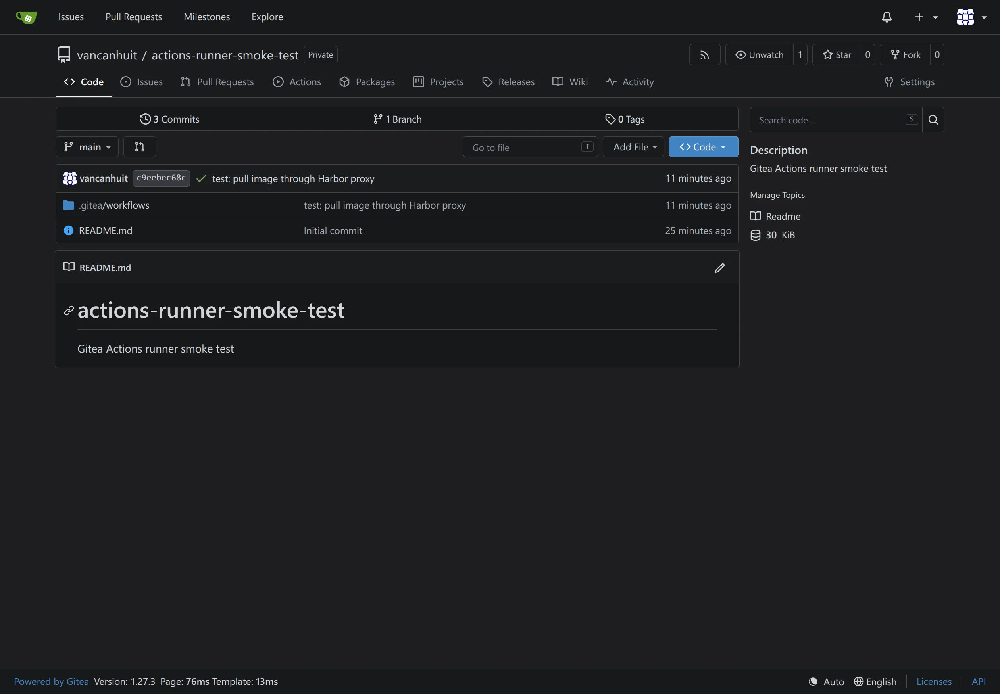

# Gitea operations

## First login

Open `https://gitea.lab.canhdinh.com/` and sign in as `gitea-admin`. The initial password is stored in the SOPS key `gitea_admin_password`; Gitea requires an immediate password change on first login.

User registration is enabled, and new accounts must confirm their email address through the configured Brevo transactional mail service.

Gitea also provides [Argo CD SSO](../kubernetes/argocd/README.md#gitea-sso).
The two OAuth applications are instance-wide and managed under Site Administration
at `https://gitea.lab.canhdinh.com/-/admin/applications`. They are not owned by
`gitea-admin` or another user. The web client secret is stored separately as a
Vault-sourced Kubernetes Secret, with a SOPS-encrypted recovery backup outside
Gitea inventory.
Argo CD grants `vancanhuit` (OIDC subject `2`) admin and other authenticated
Gitea accounts read-only access. Email-confirmed registration therefore also
allows new accounts to read Argo CD resources.

Gitea also provides [Vault SSO](../vault/README.md) through a separate instance-wide
confidential **Vault** application (ID `10`). Its credentials are encrypted under
`secrets/vault/`, outside Ansible inventory. Vault administration is restricted to
subject `2`; other accounts can sign in but cannot access shared secrets or
administration. Vault identities use verified email addresses; administrator
authorization independently requires the stable subject.

## Repository interface

Use the repository navigation bar to browse source, issues, pull requests,
Actions, packages, projects, releases, and other enabled units.



## Health checks

Run these commands on the Gitea host:

```sh
sudo systemctl status gitea.service
sudo journalctl -u gitea.service --since today
sudo -u git /usr/local/bin/gitea doctor check \
  --run check-db-consistency --run hooks --run storages \
  --config /etc/gitea/app.ini
sudo systemctl status lego-renew.timer
```

## Local data volume

`/var/lib/gitea` is mounted from the Incus filesystem volume `pool1/gitea-data`
with a 20 GiB quota. It holds repositories and generated state outside the
container root disk. PostgreSQL and S3 data remain on their respective services.
Both the deployment role and systemd require this mount before starting Gitea.
Instance snapshots do not include custom volumes; back up this volume separately.

### Recovery

If the mount guard fails, keep Gitea stopped and inspect the volume from the
administrator workstation:

```sh
incus config device show homelab-server:gitea
incus storage volume get homelab-server:pool1 gitea-data size
incus exec homelab-server:gitea -- findmnt -M /var/lib/gitea
```

Require device `data` to attach `pool1/gitea-data` at `/var/lib/gitea`, with quota
`20GiB` and mount source `pool1/custom/default_gitea-data`. Repair the attachment
before restarting. If the volume's contents need recovery, stop and runtime-mask
Gitea, restore a consistent backup, and verify it before unmasking. Coordinate
repository recovery with the matching PostgreSQL database and object bucket.
Do not bypass the mount guards or overwrite newer data with an older copy.

Run `mise exec -- ansible-playbook verify-gitea.yaml` from `ansible/` after
recovery. Use the [provisioning command](incus.md#create-incus-instances) only
when creating a new container and data volume.

## Object storage

Gitea stores LFS objects, user and repository avatars, attachments, repository
archives, packages, Actions logs, and Actions artifacts in the `homelab-gitea`
bucket through the local SeaweedFS S3-compatible API. Git repository object data
remains under `/var/lib/gitea` on the Gitea host.

SeaweedFS grants Gitea a bucket-scoped identity with read, list, tagging, and write
access only to `homelab-gitea`. The separate SeaweedFS administrative identity is
not deployed to the Gitea host. Both hosts need an encrypted copy of the shared
Gitea identity. Gitea uses it as an S3 client; SeaweedFS uses it to define the
server-side authorization policy.

Run `ansible-playbook verify-gitea.yaml` after storage configuration changes. Do not inspect `/etc/gitea/app.ini` in shared or recorded terminals because it contains object-storage credentials.

Changing storage providers requires data migration as well as configuration deployment:

1. Copy the existing bucket to the destination while Gitea remains online.
2. Stop Gitea to freeze object writes.
3. Copy the final delta and compare object counts, byte totals, and contents.
4. Update the `gitea_s3_*` inventory values and run `ansible-playbook gitea.yaml`.
5. Run `ansible-playbook verify-gitea.yaml` and test existing object-backed content through Gitea.
6. Retain the source bucket for a rollback period.

To roll back a storage-provider change, stop Gitea and copy any new objects back
to the retained source bucket. Verify object counts, byte totals, and contents
before restoring the recorded `gitea_s3_*` inventory values. Then run
`ansible-playbook gitea.yaml --limit gitea` and `ansible-playbook verify-gitea.yaml`
from `ansible/`. Do not switch the endpoint before the reverse copy passes.

## Upgrade procedure

Review the target release's breaking changes, drain Actions jobs, and stop the
runner before stopping Gitea. Stop the certificate renewal timer and any active
renewal service so its deploy hook cannot restart Gitea during the backup.

On the runner host:

```sh
sudo systemctl stop gitea-runner.service
```

On the Gitea host:

```sh
sudo systemctl stop lego-renew.timer lego-renew.service
sudo systemctl stop gitea.service
```

While Gitea remains stopped, back up the `gitea` PostgreSQL database with native
`pg_dump`, the `pool1/gitea-data` custom volume, the complete `homelab-gitea`
object bucket, configuration, TLS/ACME state, and the old binary. An instance
snapshot alone does not cover the custom volume or external services. Verify an
encrypted off-host copy and rehearse database migration and restore against a
separate database before deploying. See [Backup coverage](backups-and-postgresql.md#backup-coverage).
Name the rollback set `pre<version>-YYYYMMDDTHHMMSSZ` using the target version
and UTC timestamp. Record its instance snapshot, custom-volume snapshot, host
archive, and workstation archive paths for rollback and cleanup.

Update `gitea_version`, the supported-version assertion in
`roles/gitea/tasks/validate.yaml`, the expected version in `verify-gitea.yaml`, and
the version expectations in both `roles/gitea/tests/render-config.yml` and
`roles/gitea/tests/release-case.yml`. From `ansible/`, run the focused role test,
syntax checks, and lint before deployment:

```sh
mise exec -- ansible-playbook -i localhost, roles/gitea/tests/render-config.yml
mise exec -- ansible-playbook --syntax-check gitea.yaml
mise exec -- ansible-playbook --syntax-check verify-gitea.yaml
mise exec -- ansible-lint roles/gitea gitea.yaml verify-gitea.yaml
mise exec -- ansible-playbook gitea.yaml --limit gitea
mise exec -- ansible-playbook verify-gitea.yaml
```

The deployment restarts Gitea and starts database migrations automatically.
After application checks pass, start the runner, run its smoke workflow, and
run `verify-gitea-runner.yaml`. Rerun `gitea.yaml --limit gitea` and require
`changed=0`. The deployment resumes `lego-renew.timer`.

For rollback, stop Gitea and the runner and restore the matching pre-upgrade
database, repository volume, object bucket, binary, and configuration. Restore
only the `gitea` database: a whole-cluster PostgreSQL rollback would also rewind
Harbor. An old binary cannot use a database migrated to a newer release. A
rollback to the backup discards writes accepted after the backup timestamp.

### Verify an upgrade

Before accepting the upgrade:

1. Require the explicit database consistency, repository hooks, and storage
   checks in `verify-gitea.yaml` to complete. Do not rely on `doctor --default`
   selecting those checks.
2. Test HTTPS clone, fetch, push, and pull-request merge with a temporary
   repository. Check a signed-in WebSocket connection to `/-/ws`.
3. Test LFS, package, and release attachment uploads and fresh downloads. Compare
   existing object hashes with the backup manifest.
4. Run the [runner smoke test](gitea-runner.md#smoke-test), including Docker access
   and the Harbor proxy. Open both existing and new Actions logs in the browser.
5. Confirm the runner and certificate renewal timer are active. Require
   redeployment to report `changed=0`.
6. Remove temporary repositories, packages, and access tokens. Complete the
   upgrade-backup cleanup below after all checks pass.

Preserve `RUN_RETENTION_DAYS = 0` for Actions run records; logs and artifacts use
their own retention policies. Keep `ROOT_URL` and email-confirmed registration
explicit.

## Clean up upgrade backups

Keep the upgrade rollback set while deployment or verification is incomplete.
After every post-upgrade check passes, remove that set's instance snapshot,
custom-volume snapshot, encrypted archives, and temporary backup staging.
Deleting the set ends the pre-upgrade rollback option; routine backups follow
their own retention policy.

From the administrator workstation, list the snapshots and select the exact
set recorded for the completed upgrade:

```sh
incus info homelab-server:gitea
incus storage volume info homelab-server:pool1 gitea-data
```

In Bash, replace the placeholder with that set's name. Stop if any deletion fails:

```bash
set -euo pipefail
backup_set='<exact-upgrade-backup-set>'
[[ "$backup_set" =~ ^pre[0-9]+(\.[0-9]+)*-[0-9]{8}T[0-9]{6}Z$ ]]
incus snapshot delete homelab-server:gitea "$backup_set"
incus storage volume snapshot delete homelab-server:pool1 gitea-data "$backup_set"
incus exec homelab-server:gitea -- rm -- "/var/backups/gitea/$backup_set.tar.age"
rm -- "$HOME/.local/state/homelab-backups/gitea/$backup_set.tar.age"
```

Remove any additional staging files by their exact recorded paths. List the
snapshots and archive directories again to confirm the selected set is absent.
Do not delete the live `gitea-data` volume, object bucket, or scheduled snapshots.
