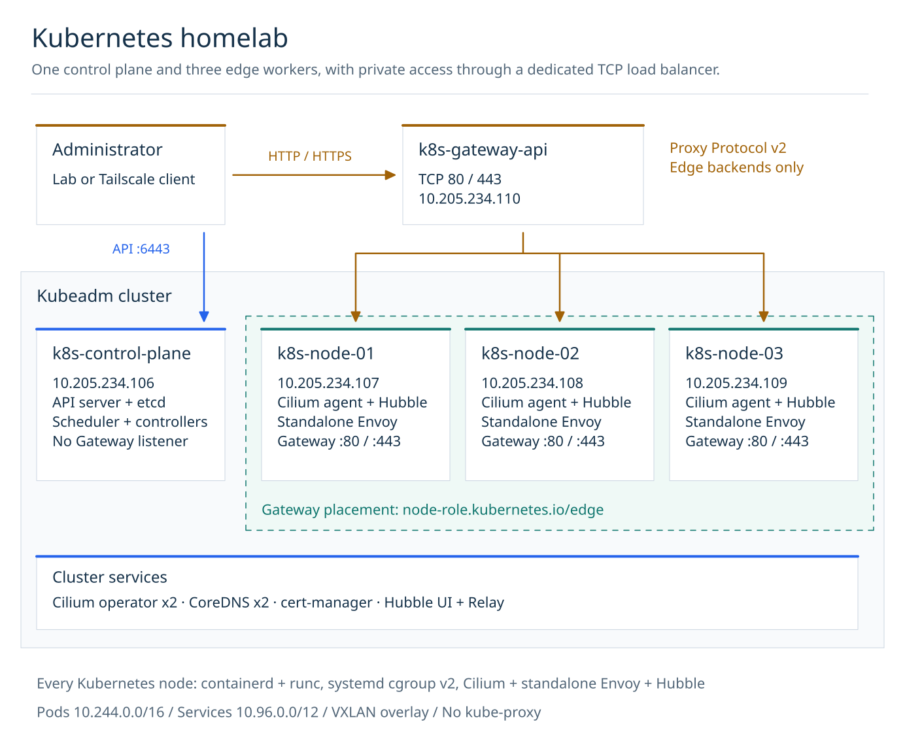
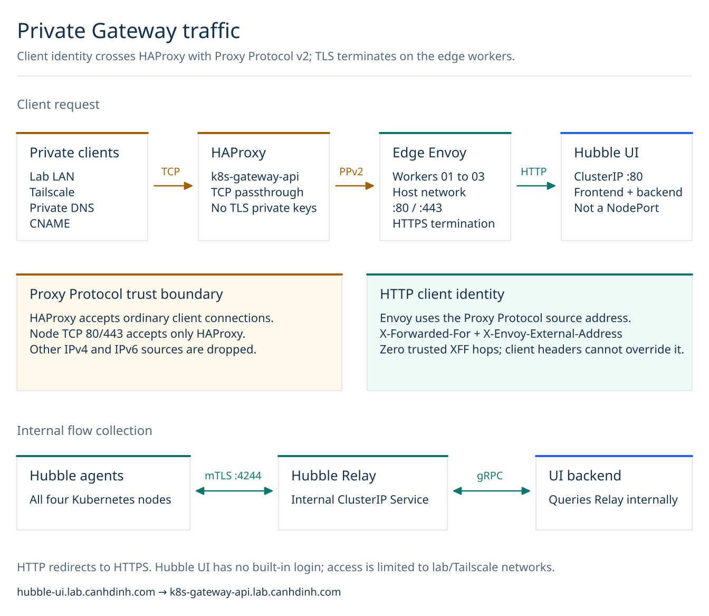
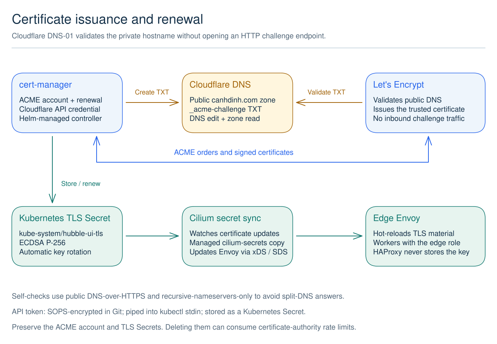

# Kubernetes

The kubeadm cluster has one control plane and three workers, all Debian 13 Incus
VMs with 2 vCPUs and 4 GiB RAM. Kubernetes runs on containerd and runc with the
systemd cgroup driver and the unified cgroup v2 hierarchy. Cilium replaces
kube-proxy; kubeadm skips the proxy addon and records `proxy.disabled: true` for
subsequent kubeadm operations.

## Architecture diagrams



[Edit the topology in Excalidraw](diagrams/kubernetes-topology.excalidraw).
The [traffic diagram](#traffic-and-client-identity) and
[certificate diagram](#certificates-and-renewal) below cover the request and
renewal paths. Sources and SVG previews are versioned together in
[`docs/diagrams/`](diagrams/README.md); no hosted diagram link is required.

| Node | DNS hostname | Initial IPv4 address |
| --- | --- | --- |
| Control plane | `k8s-control-plane.lab.canhdinh.com` | `10.205.234.106` |
| Worker 1 | `k8s-node-01.lab.canhdinh.com` | `10.205.234.107` |
| Worker 2 | `k8s-node-02.lab.canhdinh.com` | `10.205.234.108` |
| Worker 3 | `k8s-node-03.lab.canhdinh.com` | `10.205.234.109` |
| TCP load balancer (not a Kubernetes node) | `k8s-gateway-api.lab.canhdinh.com` | `10.205.234.110` |

The API endpoint is `k8s-control-plane.lab.canhdinh.com:6443`. Ansible also connects
using DNS names. **Keep the control-plane IP stable**, preferably with a
Technitium DHCP reservation. DNS alone does not handle renumbering: kubeadm's API
server and etcd static manifests embed the bootstrap IP address.

## Versions and networking

Pins and SHA-256 checksums are in
`ansible/roles/kubernetes/defaults/main.yaml`: Kubernetes 1.36.5, containerd 2.4.2,
runc 1.5.2, CNI plugins 1.9.1, crictl 1.36.0, Cilium 1.20.3, Cilium CLI 0.20.1,
Hubble CLI 1.20.2, and Gateway API 1.6.3 (standard channel).
cert-manager uses the official OCI Helm chart pinned to 1.21.2 in the
[application commands](../kubernetes/README.md), with lab settings in
`kubernetes/cert-manager/values.yaml`. HAProxy uses Debian 13's
distribution-supported package.
Kubernetes 1.36 is in Cilium 1.20's tested compatibility matrix. The node binaries,
including runc and the standard CNI plugins, come from official upstream releases,
not distribution packages. This avoids a package dependency replacing the manually
installed CNI plugins. Manage their security updates explicitly.

- Pod CIDR: **`10.244.0.0/16`**, with a `/24` per node allocated by Kubernetes.
- Service CIDR: `10.96.0.0/12`.
- Cilium IPAM: `kubernetes`, using each Node's PodCIDR.
- Envoy: standalone `cilium-envoy` DaemonSet (`envoy.enabled: true`), not embedded
  in the Cilium agent.
- Hubble: enabled with Relay as an internal ClusterIP Service. Agent-to-Relay
  connections use mTLS, with automatic certificate renewal through certgen's CronJob.
- Gateway API: Cilium controller with host networking, using the `cilium` GatewayClass.
- Routing: VXLAN overlay; no Pod routes are needed on the Incus bridge.
- Cilium connects directly to the DNS API endpoint during bootstrap, before
  Kubernetes Service routing exists.

All nodes need outbound HTTPS and working DNS to download binaries and images.
Allow TCP 6443 to the control plane, TCP 10250 between nodes, UDP 8472 for VXLAN,
TCP 4240 and ICMP between nodes for Cilium health checks. Keep etcd TCP 2379–2380
restricted to the control plane. Do not expose the API or kubelet publicly.
Allow TCP 4244 from Hubble Relay to each node for the mTLS-protected Hubble API.
If using NodePort Services, permit only the needed ports in TCP/UDP 30000–32767.

## Deploy and verify

From `ansible/`:

```sh
mise exec -- ansible-playbook kubernetes.yaml
mise exec -- ansible-playbook verify-kubernetes.yaml
mise exec -- ansible-playbook kubernetes.yaml
```

The repeat deployment should report `changed=0`. The playbook never resets a
cluster or reruns a worker join when `/etc/kubernetes/kubelet.conf` already exists.
It refuses an implicit Kubernetes version change or adoption of a different
installation. A partial failed initialization needs investigation, not an
automatic `kubeadm reset`, because reset can destroy cluster state.

Worker join commands are generated only for unjoined workers. Their tokens expire
after 15 minutes, are hidden from Ansible output, and are revoked after the join stage.
No bootstrap token or kubeconfig is committed to the repository. Kubernetes
nodes are outside the inventory's `lab` group and do not inherit its Cloudflare
credential. cert-manager's separate credential is an encrypted Kubernetes Secret
under `kubernetes/cert-manager/`; no Ansible inventory host owns it.

The administrator kubeconfig is installed with mode `0600` at
`/home/admin/.kube/config` on the control plane. Access without copying credentials:

```sh
ssh admin@k8s-control-plane.lab.canhdinh.com 'kubectl get nodes -o wide'
ssh admin@k8s-control-plane.lab.canhdinh.com 'kubectl get pods -A -o wide'
ssh admin@k8s-control-plane.lab.canhdinh.com 'cilium status --wait'
```

This control host also has an explicitly imported `lab-kubeadm` context in
`~/.kube/config` (mode `0600`); use `kubectl --context lab-kubeadm get nodes`.
The playbook does not copy kubeconfigs to controllers automatically.

Verification checks all four nodes, control-plane membership, CRI health, binary
versions, systemd cgroups, cgroup v2, CoreDNS, absence of the kube-proxy DaemonSet
and ConfigMap, full kube-proxy replacement on every Cilium agent, Hubble Relay
connectivity to all four nodes, Gateway API CRD versions, and the accepted `cilium`
GatewayClass with host-network configuration.
Run connectivity tests separately; they create workloads and network policies,
unlike the read-only verification playbook. On the control plane as `admin`:

```sh
ssh admin@k8s-control-plane.lab.canhdinh.com
cilium connectivity test --hubble=false \
  --test 'no-policies|client-ingress-knp|all-egress-deny-knp|echo-ingress-l7|client-egress-l7-method'
relay_ip=$(kubectl -n kube-system get service hubble-relay -o jsonpath='{.spec.clusterIP}')
cilium connectivity test --hubble-server "$relay_ip:80" \
  --flow-validation strict --test 'client-egress-l7-method/'
cilium connectivity test --cleanup
```

The dataplane check passed 8 tests / 183 actions, and the strict Hubble L7 check
passed 1 test / 18 actions. The full 135-test suite was not completed.
Strict Pod-to-Service flow matching timed out: the matcher expected a TCP SYN
addressed to the Service IP, while Hubble recorded the socket-LB pre-translation
event and the backend Pod's TCP SYN. Service requests themselves succeeded.
Do not disable socket load balancing merely to satisfy this flow expectation.

Controller-local template and network-overlap tests:

```sh
mise exec -- ansible-playbook -i localhost, roles/kubernetes/tests/render-config.yml
```

## Gateway API with host networking

The playbook downloads the checksum-pinned official Gateway API 1.6.3
[`standard-install.yaml`](https://github.com/kubernetes-sigs/gateway-api/releases/download/v1.6.3/standard-install.yaml).
It reconciles all ten CRDs and the bundled safe-upgrade admission policies using
server-side diff/apply without forcing field ownership conflicts, then waits for
the CRDs to become established before installing or updating Cilium. The admission
policies prevent unsafe CRD upgrades; they do not have an `Established` condition.
Experimental API fields are not installed.

Cilium enables `gatewayAPI.enabled` and `gatewayAPI.hostNetwork.enabled` and
creates the `cilium` GatewayClass (`io.cilium/gateway-controller`). Configuration
changes automatically roll out both agents and operators, so the operator detects
the CRDs at startup. Standalone Envoy retains its existing capabilities and gains
`NET_BIND_SERVICE`, allowing listeners on ports such as 80 and 443.

The base `kubernetes.yaml` playbook enables the controller, Hubble UI, and Proxy
Protocol support, but does not create application listeners. The
`kubernetes-gateway.yaml` entrypoint adds HAProxy configuration. The certificate,
Gateway, and routes are applied separately from `kubernetes/` using `kubectl`.
HTTP, HTTPS, gRPC, and TLS listeners
bind directly on the node network rather than relying on a LoadBalancer Service.
Only the three workers with the `edge` role host the Hubble UI listeners;
the control plane does not. The Cilium Helm selector is
`gatewayAPI.hostNetwork.nodes.matchLabels: {node-role.kubernetes.io/edge: ''}`.
The `k8s_edge` inventory group owns the edge membership and preserves these node
labels after worker joins. Cilium agents and standalone Envoy remain deployed
cluster-wide for CNI and L7 network policies; only Gateway sockets are edge-only.

Host-network listeners bind all node interfaces. Ports 80 and 443 are reserved
for the `kube-system/hubble-ui` Gateway. Do not create a second Gateway using the
same ports. `TCPRoute` and `UDPRoute` CRDs are installed by the standard
bundle, but Cilium does not expose those routes directly through host networking;
their generated Services use NodePorts instead.

Cilium's Gateway API chart also confines socket load balancing to the host
namespace. The earlier connectivity results above predate this configuration.
`verify-kubernetes-gateway.yaml` additionally checks real Hubble UI HTTPS traffic,
certificate validation, HTTP redirection, routes, and the node firewall.

### Deploy HAProxy, cert-manager, and Hubble UI

From `ansible/`:

```sh
mise exec -- ansible-playbook kubernetes-gateway.yaml
mise exec -- ansible-playbook kubernetes-gateway.yaml
```

The entrypoint reconciles the cluster and HAProxy only. The repeat run should
report `changed=0` on all five hosts. Then follow
[`kubernetes/README.md`](../kubernetes/README.md) from the repository root to
install cert-manager with Helm and apply its DNS-01 issuer, the Hubble UI
certificate, and Gateway routes with `kubectl`. It includes the one-time adoption
step for the existing static-manifest cert-manager installation. Application
updates no longer require any Ansible playbook.

After the applications are ready, optionally run
`mise exec -- ansible-playbook verify-kubernetes-gateway.yaml` from `ansible/`
for the read-only end-to-end checks.
Open **https://hubble-ui.lab.canhdinh.com/** from the lab or Tailscale network.
The existing private CNAME points to `k8s-gateway-api.lab.canhdinh.com`; the playbook
does not modify the UI DNS record. HTTP redirects to HTTPS.

### Traffic and client identity



[Edit the traffic diagram in Excalidraw](diagrams/kubernetes-gateway.excalidraw).

HAProxy passes TCP 80 and 443 only to `k8s_edge` nodes, uses DNS-based backend discovery
and TCP health checks, and sends `send-proxy-v2` on each backend connection.
It does not terminate TLS or accept client-supplied Proxy Protocol headers.
Cilium's `gatewayAPI.enableProxyProtocol=true` requires Proxy Protocol for every
Gateway listener. Envoy terminates TLS using `kube-system/hubble-ui-tls` and passes
the original address to HTTP backends in `X-Forwarded-For` and
`X-Envoy-External-Address`, with zero trusted XFF hops. An upstream NAT can still
hide a client's address before traffic reaches HAProxy.

Each Kubernetes node owns a dedicated `inet lab_gateway` nftables table, loaded
at boot before containerd and kubelet. It permits TCP 80/443 only from HAProxy's
resolved IPv4 address, then drops all other IPv4 and IPv6 sources on those ports.
It never flushes Cilium or kubelet tables. This restriction is necessary because
Proxy Protocol headers are not authenticated. New listener ports require matching
firewall and HAProxy updates before use. If the HAProxy address changes, rerun the
deployment to refresh the node allowlist and HAProxy bind address.

HAProxy binds its private LAN address and permits only `10.205.234.0/24` and
`100.64.0.0/10`, configured in `ansible/host_vars/k8s-gateway-api/vars.yaml`.
**Hubble UI has no login and exposes sensitive flow metadata.** Keep these network
boundaries and Tailscale ACLs in place; add authentication before wider exposure.
The Relay and UI Services remain ClusterIP; only the Gateway is exposed.

### Certificates and renewal

cert-manager comes from the version- and digest-pinned official Helm chart. Its upstream
security settings are preserved; lab values enable retained CRDs and public
DNS-01 self-check resolvers. The `letsencrypt-cloudflare` ClusterIssuer uses
Cloudflare DNS-01 for `lab.canhdinh.com`, storing its account key in the
`cert-manager` namespace.
The explicit `Certificate` resource requests only `hubble-ui.lab.canhdinh.com`.
It uses ECDSA P-256 and renews automatically, rotating the key on renewal.
No Gateway annotation or cert-manager Gateway shim is required.



[Edit the certificate diagram in Excalidraw](diagrams/kubernetes-certificates.excalidraw).

Cloudflare needs `Zone:DNS:Edit` and `Zone:Zone:Read` on the `canhdinh.com` zone.
The credential is SOPS-encrypted in
`kubernetes/cert-manager/cloudflare-api-token.sops.yaml` and decrypted directly
into `kubectl`'s stdin, without writing a plaintext manifest. It is no longer an
Ansible inventory variable. The initial credential reuses the existing lab token.
Replacing it with a dedicated zone-scoped token reduces the shared rotation and
revocation impact; edit the encrypted Kubernetes Secret with SOPS and reapply it
as described in the [application guide](../kubernetes/README.md#2-apply-the-cloudflare-credential-and-issuer).

The pod network's port-53 queries to public resolvers returned empty TXT answers
even though external queries could see the Cloudflare challenge. cert-manager
therefore uses `--dns01-recursive-nameservers-only` with Cloudflare's public
DNS-over-HTTPS endpoints at `https://1.1.1.1/dns-query` and
`https://1.0.0.1/dns-query`. Outbound HTTPS must remain allowed for Cloudflare,
Let's Encrypt, and DoH. The internal application CNAME does not require
`cnameStrategy: Follow`; that setting is for delegating `_acme-challenge` records.

Inspect readiness without printing Secrets:

```sh
kubectl --context lab-kubeadm get pods -n cert-manager
kubectl --context lab-kubeadm get clusterissuer letsencrypt-cloudflare
kubectl --context lab-kubeadm -n kube-system get certificate,gateway,httproute
kubectl --context lab-kubeadm -n kube-system get challenges,orders
```

Do not delete the ACME account Secret or TLS Secret to retry issuance: doing so
can consume CA rate limits. Fix DNS or credentials and allow the existing request
to reconcile. To stop UI exposure without deleting certificate state, stop HAProxy
and remove the two Hubble UI HTTPRoutes; reapplying
`kubernetes/hubble-ui/gateway.yaml` restores them.

### Verified deployment

Before the application extraction, the complete Ansible deployment rerun reported
`changed=0` on the control plane, all three
workers, HAProxy, and the local verification host. Both listener checks pass on
all three edge nodes; no Gateway socket is present on the control plane.
HTTPS certificate validation, HTTP redirection, and Hubble UI's live flow display
were checked. The UI reported all four Hubble nodes connected.

A temporary HTTP echo backend verified that Envoy forwarded the actual Tailscale
client address, not HAProxy's address. Injecting a forged `X-Forwarded-For` value
did not replace `X-Envoy-External-Address`. Direct untrusted HTTPS connections to
each node were blocked. The temporary Pod, Service, and HTTPRoute were removed.

On **2026-10-18**, cert-manager was adopted in place into the official Helm chart
at v1.21.2, release `cert-manager` in namespace `cert-manager`, revision 1. An
age-encrypted resource backup was created and decrypt-verified before adoption.
All 46 existing chart resources retained their UIDs, as did the issuer and
certificate resources. The Cloudflare token, ACME account, Hubble TLS Secret,
and Cilium's synced TLS Secret retained both their identities and contents.
All three controller Deployments, the issuer, Certificate, and Gateway were ready
afterward; Hubble UI returned trusted HTTPS `200` and an HTTP `301` redirect.
Future updates use the regular Helm command without `--take-ownership` in the
[application guide](../kubernetes/README.md#1-install-or-update-cert-manager).

## Observe flows with Hubble

The Hubble CLI is installed on the control plane. Start a loopback-only forward
to Relay, leaving this command running:

```sh
ssh admin@k8s-control-plane.lab.canhdinh.com 'cilium hubble port-forward'
```

In a second terminal:

```sh
ssh admin@k8s-control-plane.lab.canhdinh.com 'hubble status'
ssh admin@k8s-control-plane.lab.canhdinh.com 'hubble observe --last 20'
```

Stop the forward with Ctrl-C. The UI is also available through the private HTTPS
Gateway above. Relay remains internal-only; public access is not enabled.

## Limits

This is not an HA cluster: losing the control plane makes the Kubernetes API and
scheduling unavailable. There is no etcd backup automation, storage provisioner,
Ingress controller, Kubernetes LoadBalancer IP allocator, or monitoring stack in
this deployment. Add backups before storing important cluster state. Incus root
disks hold `/var/lib/etcd` and `/var/lib/containerd`.
The single HAProxy host is another single point of failure. Certificate/account
Secrets live in etcd; protect access to them and include them in encrypted backups.

Changing version pins is not a rolling-upgrade procedure. Follow the upstream
kubeadm and Cilium upgrade guides, back up etcd, and drain workers as appropriate.

## References

- [Create a kubeadm cluster](https://kubernetes.io/docs/setup/production-environment/tools/kubeadm/create-cluster-kubeadm/)
- [Install kubeadm and node binaries](https://kubernetes.io/docs/setup/production-environment/tools/kubeadm/install-kubeadm/)
- [Container runtimes and systemd cgroups](https://kubernetes.io/docs/setup/production-environment/container-runtimes/)
- [Official containerd, runc, and CNI installation](https://github.com/containerd/containerd/blob/v2.4.2/docs/getting-started.md)
- [Cilium without kube-proxy](https://docs.cilium.io/en/v1.20/network/kubernetes/kubeproxy-free/)
- [Cilium Kubernetes compatibility](https://docs.cilium.io/en/v1.20/network/kubernetes/requirements/)
- [Cilium Kubernetes IPAM](https://docs.cilium.io/en/v1.20/network/concepts/ipam/kubernetes/)
- [Hubble TLS and certificate renewal](https://docs.cilium.io/en/v1.20/observability/hubble/configuration/tls/)
- [Cilium Gateway API and host networking](https://docs.cilium.io/en/v1.20/network/servicemesh/gateway-api/gateway-api/)
- [HAProxy Proxy Protocol configuration](https://www.haproxy.com/documentation/haproxy-configuration-tutorials/proxying-essentials/client-ip-preservation/enable-proxy-protocol/)
- [cert-manager Helm installation](https://cert-manager.io/docs/installation/helm/)
- [cert-manager Cloudflare DNS-01](https://cert-manager.io/docs/configuration/acme/dns01/cloudflare/)
- [DNS-01 self-checks and split DNS](https://cert-manager.io/docs/configuration/acme/dns01/)
- [cert-manager DNS-over-HTTPS controller flags](https://cert-manager.io/docs/cli/controller/)
